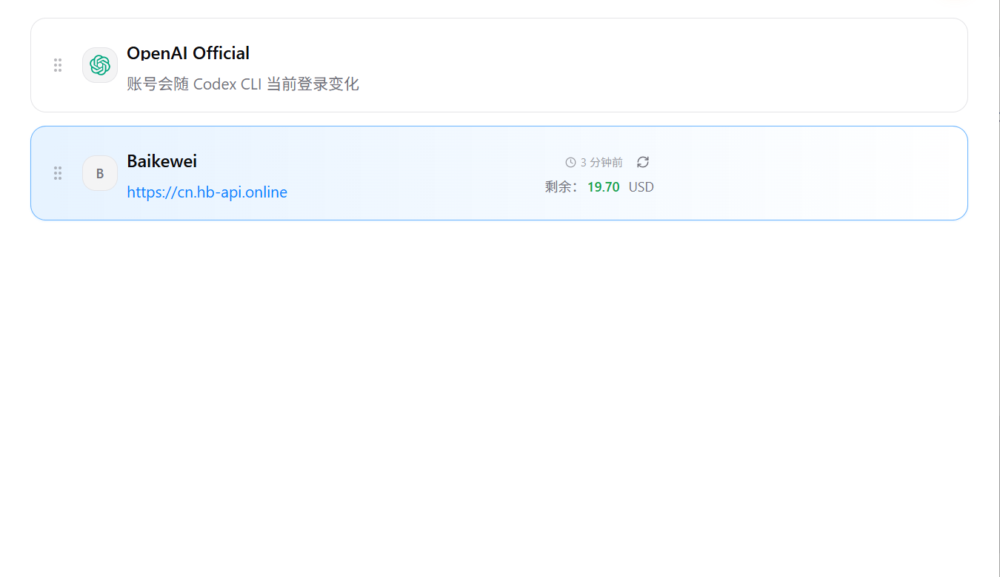
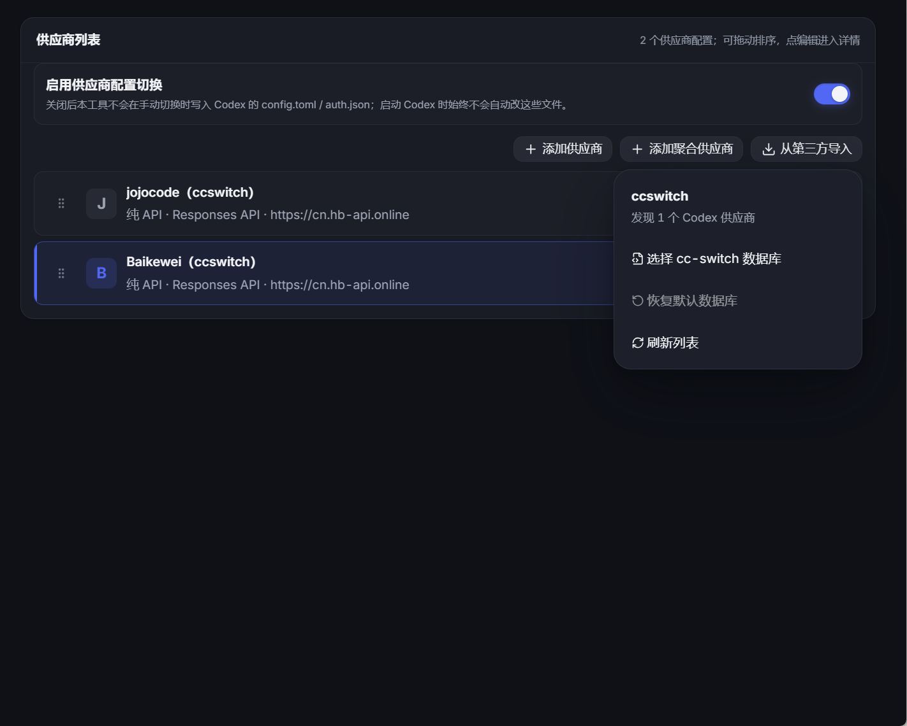

# Codex 第三方 API 接入笔记


> 记录一次将 Codex 接入第三方 OpenAI-compatible API 的实践。
>
> 本文以 Windows 为例，工具名称以 `codex++` 和 `CC Switch` 为例。不同版本的界面、菜单名称和配置字段可能略有差异，实际使用时应以工具仓库和本机版本为准。

## 1. 先理解整体结构

Codex 的第三方 API 接入，核心不是“修改模型名称”，而是配置一个兼容 OpenAI API 协议的 Provider：

```text
Codex
  -> Provider 配置
  -> base_url + API key + model
  -> 第三方中转/聚合服务
  -> 上游模型服务
```

通常需要准备三项信息：

| 配置项     | 含义                           | 示例                                |
| ---------- | ------------------------------ | ----------------------------------- |
| `base_url` | API 根地址，通常需要包含 `/v1` | `https://example.com/v1`            |
| `api_key`  | 第三方平台签发的密钥           | `sk-...`                            |
| `model`    | 平台实际支持的模型名           | `gpt-5`、`gpt-4.1` 或平台自定义名称 |

最容易出错的地方是：第三方平台宣传的模型名，不一定等于 API 请求中真正需要填写的模型名。应优先查看平台的模型列表或接口文档。

## 2. Codex++ 和 CC Switch 各自负责什么

### 2.1 Codex++

这里把 [codex++]([Codex++ - Codex 桌面增强与管理工具](https://codexpp.cc/)) 理解为 Codex 的增强启动、配置切换或环境管理工具。它通常适合做下面几类事情：

- 快速选择不同的 Provider；
- 管理多个 API 配置；
- 注入环境变量；
- 通过快捷方式启动不同的 Codex 配置；
- 在多个账号、多个中转站之间切换。

它并不一定是 API 服务本身。真正负责转发请求的，通常是第三方 API 平台或本地代理服务。

### 2.2 CC Switch

[CC Switch](https://ccswitch.io/zh/) 更适合作为配置管理和 Provider 切换工具。常见使用方式是：

1. 添加一个 OpenAI-compatible Provider；
2. 填写 API 地址、密钥和模型；
3. 选择当前生效的配置；
4. 由 CC Switch 写入或生成 Codex 使用的配置；
5. 启动 Codex 进行验证。

可以把两者简单理解成：

```text
CC Switch：管理和切换配置
Codex++：辅助启动、切换或增强使用体验
Codex：真正发起模型请求
第三方 API：接收并转发请求
```

## 3. 准备第三方 API

选择第三方 API 时，至少确认以下信息：

- 是否兼容 OpenAI API；
- 是否支持 Codex 所需的请求格式；
- 是否支持流式输出；
- 是否支持目标模型；
- `base_url` 是否要求 `/v1`；
- 是否有额外的请求头或渠道参数；
- 是否限制上下文长度、并发数或请求频率；
- 是否会记录请求内容。

一个通用的配置草稿如下：

```text
Provider name: my-provider
Base URL:      https://api.example.com/v1
API key:       sk-xxxxxxxx
Model:         your-model-name
```

我这里用的是[百可为AI](https://cn.hb-api.online/home)。

## 4. 使用 CC Switch 添加 Provider

### 4.1 新建 Provider

打开 CC Switch，进入 Provider 或 API 配置页面，新建一个 OpenAI-compatible 配置。

建议使用一个容易识别的名称，例如：

```text
my-provider-gpt
```

然后填写：

```text
API Base URL: https://api.example.com/v1
API Key:      sk-xxxxxxxx
Model:        your-model-name
```

如果 CC Switch 提供协议类型选项，优先选择：

```text
OpenAI Compatible
```

如果工具要求分别填写“聊天接口”和“响应接口”，应先确认第三方平台支持哪一种协议。部分平台只兼容 Chat Completions，部分平台同时兼容 Responses API。

一般来说中转站有直接导入CCSwitch的设置，这样比较方便，，配置好后如图所示：



### 4.2 配置文件思路

不同版本可能采用不同的文件结构，但逻辑通常可以抽象为：

```toml
[providers.my_provider]
name = "my-provider-gpt"
base_url = "https://api.example.com/v1"
api_key = "sk-xxxxxxxx"
model = "your-model-name"
```

上面只是结构示意，不能保证适用于所有 CC Switch 版本。若工具已经生成了配置文件，建议优先通过工具界面修改，不要手动改动未知字段。

### 4.3 保存后检查

保存配置后，重点检查：

- URL 是否多写或少写了 `/v1`；
- 是否误填了网页地址而不是 API 地址；
- 模型名大小写是否一致；
- API key 前后是否有空格；
- 是否把 `Bearer ` 一并填进了 API key 输入框；
- 是否选择了刚刚创建的 Provider。

## 5. 使用 Codex++ 进行切换或启动

如果 Codex++ 提供 Provider 列表，可以为不同服务分别建立配置：

```text
OpenAI 官方
公司内部网关
第三方聚合 API
本地兼容服务
```

建议每个 Provider 使用独立名称，不要反复覆盖同一个配置。例如：

```text
official
company-gateway
third-party-fast
local-test
```

启动前确认当前生效的 Provider。很多“配置没有生效”的问题，实际原因只是切换工具仍然选中了另一个配置。

如果 Codex++ 支持环境变量注入，也可以采用下面这种思路：

```powershell
$env:OPENAI_API_KEY = "sk-xxxxxxxx"
$env:OPENAI_BASE_URL = "https://api.example.com/v1"
codex
```

变量名称会因工具和版本不同而变化。若环境变量没有效果，应以 Codex 的实际配置文件和启动日志为准。

Codex++支持导入CCswitch的配置，建议直接导入比较方便。



## 6. Codex 原生配置思路

Codex 的配置一般位于用户目录下的配置文件中，常见文件名是：

```text
~/.codex/config.toml
```

Windows 下对应的用户目录通常可以通过环境变量确认：

```powershell
$HOME
```

一个概念性的 Provider 配置示例：

```toml
[model_providers.my_provider]
name = "my-provider"
base_url = "https://api.example.com/v1"
env_key = "MY_PROVIDER_API_KEY"

[profiles.third_party]
model_provider = "my_provider"
model = "your-model-name"
```

注意：具体字段名会随 Codex 版本变化。不要直接复制这段配置覆盖现有文件，先查看当前版本的配置文档或由 CC Switch 自动生成配置。

如果使用环境变量保存密钥，可以这样做：

```powershell
[Environment]::SetEnvironmentVariable(
  "MY_PROVIDER_API_KEY",
  "sk-xxxxxxxx",
  "User"
)
```

设置后需要重新打开终端或重启相关程序，确保新环境变量被读取。

## 7. 用 curl 先验证 API，再验证 Codex

在排查问题时，建议先绕开 Codex，用最小请求验证第三方 API。这样可以区分“API 不通”和“Codex 配置错误”。

### 7.1 Chat Completions 兼容接口

```powershell
$headers = @{
  Authorization = "Bearer $env:MY_PROVIDER_API_KEY"
  "Content-Type" = "application/json"
}

$body = @{
  model = "your-model-name"
  messages = @(
    @{
      role = "user"
      content = "请只回复：连接成功"
    }
  )
} | ConvertTo-Json -Depth 5

Invoke-RestMethod `
  -Method Post `
  -Uri "https://api.example.com/v1/chat/completions" `
  -Headers $headers `
  -Body $body
```

### 7.2 常见返回结果

成功时，通常可以看到类似以下结构：

```json
{
  "id": "chatcmpl-xxx",
  "choices": [
    {
      "message": {
        "role": "assistant",
        "content": "连接成功"
      }
    }
  ]
}
```

如果这个请求失败，就先不要继续排查 Codex，优先检查第三方 API 的地址、密钥、模型名和协议兼容性。

## 8. 常见问题排查

### 8.1 `401 Unauthorized`

可能原因：

- API key 错误、过期或被撤销；
- Authorization 头格式错误；
- 把 `sk-...` 填到了 URL 中；
- CC Switch 仍在使用旧密钥；
- 第三方平台要求额外的渠道密钥。

处理方式：

1. 在第三方平台重新生成或复制 API key；
2. 删除输入框前后的空格；
3. 重新保存 Provider；
4. 重新启动 CC Switch 和 Codex；
5. 用最小 curl 请求确认密钥本身有效。

### 8.2 `404 Not Found`

最常见原因是 `base_url` 层级不对。例如工具会自动拼接 `/chat/completions`，但你把完整接口地址填成了 `base_url`：

```text
错误： https://api.example.com/v1/chat/completions
正确： https://api.example.com/v1
```

也有些平台的根地址不带 `/v1`，不能机械添加。以平台文档为准。

### 8.3 `400 Bad Request`

通常与请求协议或模型名有关：

- 模型名称不存在；
- 第三方只支持 Chat Completions，但客户端发送了另一种请求；
- 第三方不支持 Codex 使用的某些参数；
- 消息格式或工具调用格式不兼容。

如果普通对话能用，但工具调用、代码执行或长上下文失败，通常说明只是“部分兼容”，而不是完全兼容。

### 8.4 能返回内容，但 Codex 不能正常工作

第三方 API 可能只实现了最基础的文本对话接口，没有完整实现 Codex 所需能力，例如：

- 流式事件不完整；
- 工具调用格式不兼容；
- 响应字段与 OpenAI 标准不同；
- 不支持长上下文；
- 不支持结构化输出；
- 不接受系统消息或特殊参数。

这类情况下，需要查看第三方平台的兼容性说明，或者换用明确声明支持 Codex/Responses API 的服务。

### 8.5 修改配置后没有生效

依次检查：

1. 当前启动的 Codex 是否读取了目标配置目录；
2. CC Switch 是否真的切换到了目标 Provider；
3. 是否存在环境变量覆盖配置文件；
4. 是否有多个 Codex 安装或多个用户目录；
5. 是否需要完全重启终端和 Codex。

可以先在 PowerShell 中查看相关环境变量：

```powershell
Get-ChildItem Env: | Where-Object {
  $_.Name -match "OPENAI|CODEX|PROVIDER|API"
}
```

## 9. 推荐的验证顺序

不要一上来就同时修改多个地方，建议按下面顺序操作：

1. 确认第三方平台账号和余额可用；
2. 确认模型名；
3. 用 curl 验证 API 地址和密钥；
4. 在 CC Switch 中创建 Provider；
5. 切换 Provider 后重启 Codex++；
6. 发送一句最简单的测试消息；
7. 再测试长文本、代码生成和工具调用；
8. 最后再配置多个 Provider 和快捷切换。

这样每一步只有一个变量变化，排错会快很多。

## 10. 安全注意事项

- 不要把真实 API key 提交到 Git；
- 不要把带密钥的配置文件发到群聊或博客；
- 不要在截图中暴露完整密钥；
- 给不同服务使用不同的密钥；
- 尽量设置额度、频率和来源限制；
- 定期删除不用的密钥；
- 第三方中转服务可能记录请求内容，敏感代码和隐私数据不要直接发送；
- 公司代码接入第三方服务前，应先确认公司的数据合规要求。

可以在项目目录中加入忽略规则：

```gitignore
.env
*.secret.toml
config.local.toml
```

## 11. 一份最小检查清单

```text
[ ] 第三方 API 确认支持 OpenAI-compatible
[ ] base_url 填的是根地址，不是完整请求地址
[ ] API key 没有多余空格
[ ] model 名称与平台控制台一致
[ ] curl 最小请求成功
[ ] CC Switch 已保存并选中正确 Provider
[ ] Codex++ 已重新启动
[ ] 没有环境变量覆盖配置
[ ] 没有在日志或截图中暴露密钥
```

## 12. 总结

使用 `codex++` 和 `CC Switch` 接入第三方 API，本质上是管理并切换 Codex 的 Provider 配置。最关键的三项参数是：

```text
base_url
api_key
model
```

实际操作中，先用 curl 验证 API，再交给 CC Switch 管理配置，最后通过 Codex++ 进行启动或切换，会更容易定位问题。

需要特别注意：第三方 API 的“OpenAI-compatible”通常只代表基础接口兼容，不代表一定完整支持 Codex 的所有能力。普通文本请求成功后，还应继续验证流式输出、长上下文、工具调用和实际代码工作流。

## 参考资料

- [OpenAI API 官方文档](https://platform.openai.com/docs/)
- [OpenAI Developers](https://developers.openai.com/)
- [CC Switch GitHub 仓库](https://github.com/farion1231/cc-switch)
- [CC Switch 文档](https://github.com/farion1231/cc-switch/wiki)

> 参考链接和配置字段可能随项目版本更新。发布前建议再次打开对应项目主页，确认当前版本的字段和菜单名称。

