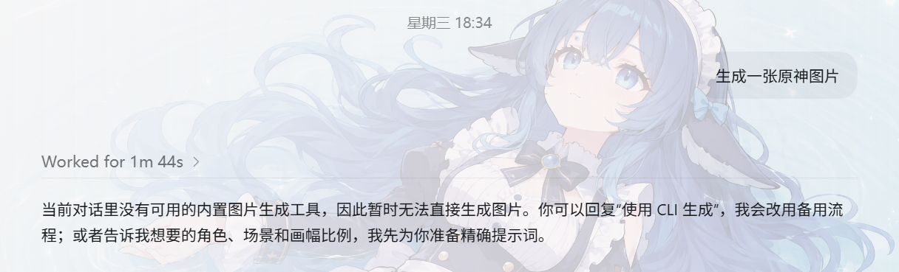
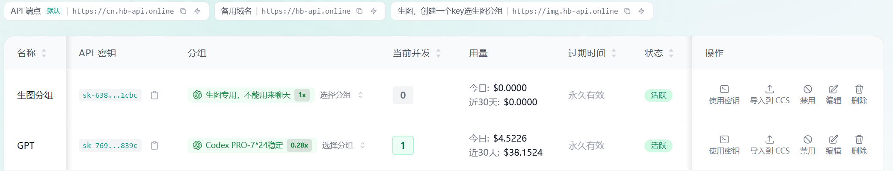
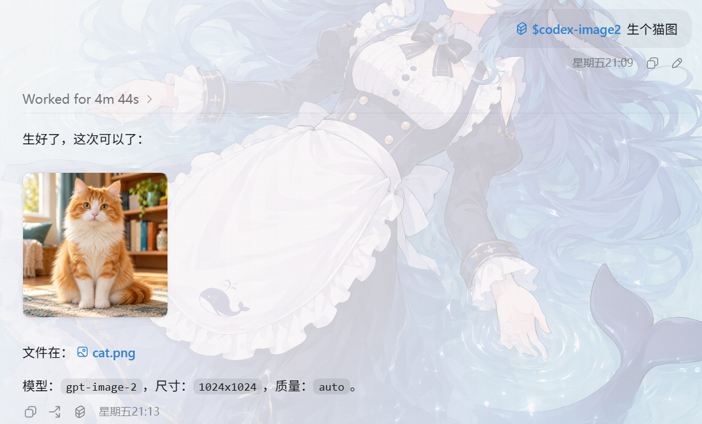
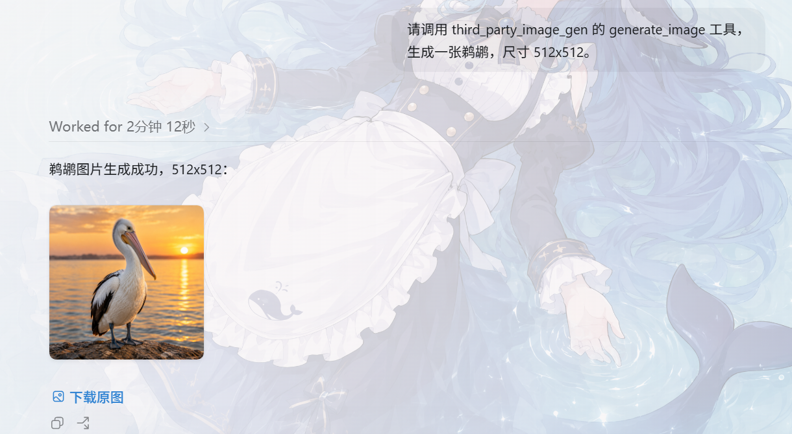

# Codex 第三方 API 中转站生图功能失败解决方案


> 由于codex使用第三方api后自带的Image Gen工具无法生图，经过寻找发现有两种方法可以解决这个问题



## 使用Skill来代替原先工具

1.打开 ChatGPT / Codex 对话，把下面两行复制发给 AI，等它安装完成即可，不需要自己敲命令：

```markdown
请帮我安装这个 Skill：
https://github.com/daifei-0/codex-image2-5-skill
```

2.登录第三方API控制台，设置好生图分组的令牌，此密钥专门用来生图使用。



```markdown
帮我配置好这个 skill 的配置。
地址：[https://img.hb-api.online/v1](https://img.hb-api.online/v1)
密钥：sk-你的密钥
请写入当前用户环境变量：
CODEX\_API\_URL=[https://img.hb-api.online/v1](https://img.hb-api.online/v1)
CODEX\_API\_KEY=sk-你的密钥
不要把完整钥匙打印到对话里。配好后告诉我下一步要重启客户端。
```


AI 提示配置完成后，彻底退出 ChatGPT / Codex 客户端再重新打开；Windows 注意退出右下角托盘中的客户端，不能只关闭窗口。
然后进入新对话，按第三步生图即可。


3.开始生图

```
使用 $codex-image2 生个猫图
```



## 用MCP工具来生图

1.打开 ChatGPT / Codex 对话，把下面两行复制发给 AI，等它安装完成即可，不需要自己敲命令：

```powershell
请帮我安装这个 MCP：
https://github.com/Tcohneyn/mcp-servers-image-gen
```

2.重启后，直接生图

```powershell
请调用 third_party_image_gen 的 generate_image 工具，
生成一张鹈鹕，尺寸 512x512。
```


