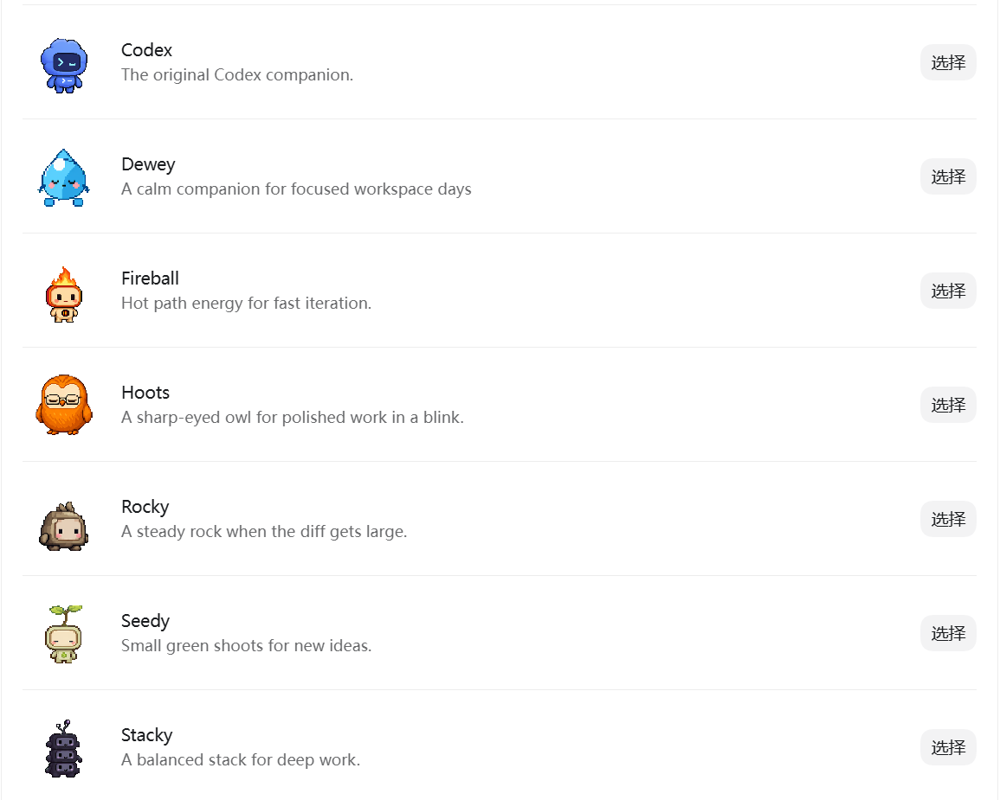
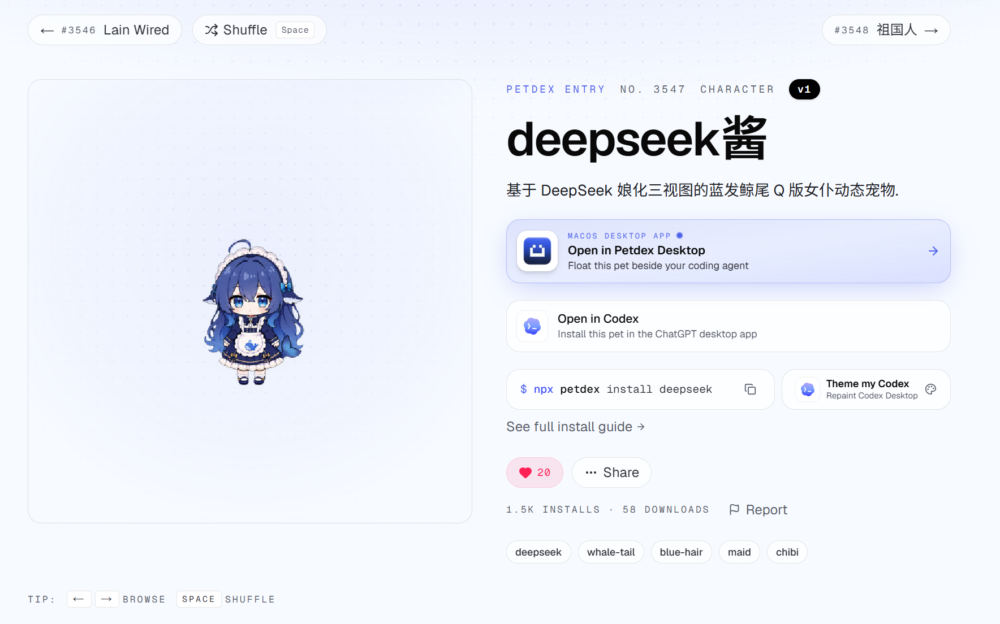

# Codex 宠物功能教程 - 制作自定义小宠物


Codex现在自带宠物功能，除了初始的9种宠物还可以自己设置自定义宠物，下面开始介绍这份功能。



## 下载成品自定义宠物

在[Petdex](https://petdex.dev/zh)网站开源了很多宠物，按照步骤可以直接下载并且安装好看的自定义宠物。



## Codex宠物特性

Codex 的自定义宠物功能，本质上是一套很轻量的本地资源：**一个 `pet.json` 文件 + 一个 `spritesheet.webp` 文件**。

`pet.json` 负责告诉 Codex：这个宠物叫什么、显示名称是什么、对应哪一张动画图。`spritesheet.webp` 则是宠物真正的视觉内容，也就是一整张包含多个动作的小动画图集。Codex 读取这两个文件后，就可以在桌面浮窗里显示这个宠物，并根据当前任务状态切换不同动作。

官方的自定义宠物一般会被安装到：

```
~/.codex/pets/<pet-name>/
  pet.json
  spritesheet.webp
```

其中，`spritesheet.webp` 不是普通单张图片，而是一张被整理好的动画合集。目的是要让同一个宠物在不同状态下有不同动作。

**当前 Codex 宠物使用 9 种状态**：`idle`、`running-right`、`running-left`、`waving`、`jumping`、`failed`、`waiting`、`running`、`review`。

| Codex 状态与场景                                          | 帧数与默认时长                       |
| :-------------------------------------------------------- | :----------------------------------- |
| `idle` 正常待机、无任务；第一帧也用于减弱动态模式         | 6 帧 280、110、110、140、140、320 ms |
| `running-right` Pet 向右移动或被拖向右侧                  | 8 帧 前7帧各120 ms，末帧220 ms       |
| `running-left` Pet 向左移动或被拖向左侧                   | 8 帧 前7帧各120 ms，末帧220 ms       |
| `waving` 问候、打招呼或吸引用户注意                       | 4 帧 前3帧各140 ms，末帧280 ms       |
| `jumping` 跳跃或交互反馈；你当前 Codex 版本中用于鼠标悬停 | 5 帧 前4帧各140 ms，末帧280 ms       |
| `failed` 任务失败、操作出错或无法完成                     | 8 帧 前7帧各140 ms，末帧240 ms       |
| `waiting` Codex 正在等待用户批准、帮助、输入或下一步指令  | 6 帧 前5帧各150 ms，末帧260 ms       |
| `running` Codex 正在执行任务、处理内容或忙碌工作          | 6 帧 前5帧各120 ms，末帧220 ms       |
| `review` Codex 正在审阅、检查或认真思考结果               | 6 帧 前5帧各150 ms，末帧280 ms       |

## 开启自定义宠物的基本步骤

创建 Codex 自定义宠物，大体可以分成五步：

1. 在 Codex 中安装 `hatch-pet` skill。
2. 准备宠物参考图和文字设定。
3. 让 Codex 先生成一个稳定的 `base` 基准形象。
4. 基于 `base` 继续生成 9 个动作状态。
5. 让 Codex 打包并安装到本地宠物目录，然后在 Codex 设置中刷新启用。

其中最重要的是第三步：**先生成一个稳定的 base 基准图**。
不要一上来就让 Codex 直接生成完整宠物。因为如果主形象没有定稳，后面的动作很容易出现“不是同一只宠物”的问题，比如脸变了、体型变了、颜色变了、道具变了。

### 第一步：安装 hatch-pet skill

在 Codex App 的聊天输入框中执行：

```
$skill-installer hatch-pet
```

### 第二步：准备宠物参考图和文字描述

参考图的作用，是告诉 Codex：这个宠物大概长什么样。文字描述的作用，是告诉 Codex：哪些地方必须稳定，哪些地方可以自由发挥。

文字描述建议覆盖这几个方面：宠物名称、外观特征、颜色、体型、性格气质、固定道具、必须保持一致的细节、不要出现的内容。

文字描述示例：

```
宠物名称：<填写宠物名称>

核心形象：
- 物种/类型：<例如小狗、小猫、机器人、熊、鸟等>
- 体型：<例如圆滚滚、矮胖、轻巧、方块感等>
- 颜色：<主要颜色和辅助颜色>
- 面部特征：<眼睛、鼻子、嘴巴、表情等>
- 固定道具：<如果有，比如帽子、背包、工具、武器、徽章等>
- 整体气质：<可爱、冷静、笨拙、专业、搞笑、神秘等>

必须保持一致：
- 脸型
- 体型
- 毛色/材质
- 道具样式
- 整体画风

不要出现：
- 复杂背景
- 文字
- 水印
- 多余道具
- 过于写实或过于复杂的细节
- 和参考图不一致的颜色或体型

请先不要生成完整宠物动作，只生成一个稳定的 base 主形象。
```

这段提示词的核心是：**先定角色，不要直接做动画**。

### 第三步：生成 base 基准图

`base` 可以理解成“宠物身份证照片”。 后面所有动作都要围绕这张图展开。

提示词：

```
$hatch-pet

基于我提供的宠物参考图和文字描述，先生成一个 base 主形象。

[这里填入你刚才准备的文字描述]

要求：
1. 只生成 base，不要生成完整动作。
2. 角色必须全身完整、居中、轮廓清楚。
3. 背景保持干净，方便后续抠图和合成。
4. 保持参考图中的核心特征，包括脸型、体型、颜色、材质和固定道具。
5. 不要加入文字、水印、复杂背景或额外道具。
6. 生成后请暂停，让我确认 base 是否可以作为后续动作的统一标准。
```

生成后要先人工检查。
检查重点不是“好不好看”，而是“能不能作为统一标准”。如果 base 有明显问题，比如角色太复杂、道具太细、背景太乱、脸部不清楚，后面动作会更容易崩。

### 第四步：基于 base 生成动作

base 确认后，不建议马上生成全部动作。 更稳的做法是：**先生成 `idle` 和 `running-right` 两个测试状态**。

`idle` 用来测试宠物站着是否稳定，`running-right` 用来测试宠物动起来以后会不会变脸、变形、丢道具。

通用提示词示例：

```
我确认当前 base 可以作为主形象继续使用。

把当前 base 作为后续所有动作的唯一视觉标准。

接下来只生成两个测试状态，不要生成其它动作：

1. idle
角色原地待机，轻微呼吸或眨眼。保持脸型、体型、颜色、材质和固定道具不变。

2. running-right
角色向右移动或小跑。动作要清楚，但不要加入速度线、烟尘、特效或复杂背景。角色不能变脸、变色、变体型，道具不能消失或变形。

生成完成后请暂停，并输出预览结果，让我检查角色一致性。
```

检查时重点看：脸是否还是同一个、体型是否稳定、颜色是否稳定、道具是否还在、动作是否清楚、背景是否干净、有没有文字或水印。

测试动作通过后，再让 Codex 继续生成完整动作。
当前 Codex 宠物使用 9 个状态：

| 状态            | 含义     | 设计建议                     |
| :-------------- | :------- | :--------------------------- |
| `idle`          | 待机     | 原地轻微呼吸、眨眼           |
| `running-right` | 向右移动 | 向右小跑或移动               |
| `running-left`  | 向左移动 | 向左小跑或移动               |
| `waving`        | 打招呼   | 轻轻挥手或挥爪               |
| `jumping`       | 跳跃     | 原地小跳，动作不要太复杂     |
| `failed`        | 失败     | 沮丧、无语、低头             |
| `waiting`       | 等待     | 发呆、左右看、等待指令       |
| `running`       | 忙碌     | 表现正在处理任务             |
| `review`        | 审阅     | 专注检查、身体前倾、认真观察 |

继续生成的提示词可以这样写：

```
idle 和 running-right 已确认可以接受。

继续基于已确认的 base、idle 和 running-right，生成剩余动作状态：

- running-left：向左移动，方向必须正确。
- waving：打招呼，动作轻微清楚。
- jumping：原地小跳，保持角色完整。
- failed：任务失败，表现为沮丧或无语，但仍然可爱。
- waiting：等待用户输入，表现为发呆、张望或轻微歪头。
- running：忙碌工作状态，表现为正在处理任务。
- review：审阅检查状态，表现为专注观察，不要新增无关道具。

所有状态必须保持同一个角色：
脸型不变，体型不变，颜色不变，材质不变，固定道具不变，画风不变。

完成后请先输出 contact sheet 和每个动作预览，不要直接最终确认。
```

这里要特别注意 `review`。 生成完整动作后，不要只看单张图。 要重点看整套动作是否统一。

### 第五步：打包和部署

当所有动作都确认后，就可以让 Codex 打包。
打包后的结果一般是：

```
~/.codex/pets/<pet-name>/
  pet.json
  spritesheet.webp
```

最终提示词示例：

```
我确认当前所有动作预览可以接受。

现在执行最终打包和安装：

1. 生成 Codex 可识别的 pet.json。
2. 生成最终 spritesheet.webp。
3. 安装到默认 Codex 宠物目录：
   ~/.codex/pets/<pet-name>/
4. 完成后告诉我最终路径。
5. 告诉我如何在 Codex App 中刷新并启用这个宠物。
```

完成后，在 Codex App 中进入：

```
Settings → Pets → Refresh
```

然后选择你的自定义宠物。

### 注意事项：Codex 宠物待机动画较慢的原因

Codex 宠物图集并不是普通 GIF，而是由应用按照固定状态、帧数和帧时长播放：待机状态 `idle` 使用 6 帧，原始时长依次为 `280、110、110、140、140、320 ms`，正常一轮约为 `1.1 秒`。 但当前 Codex 桌面端会对待机动画额外应用约 **6 倍的降速系数**，因此实际一轮接近 `6.6 秒`，看起来像几秒才变化一次。鼠标悬停时触发的 `jumping` 使用 5 帧，一轮约 `840 ms`，且不受同样的待机降速影响，所以显得非常流畅。 这种速度差来自 Codex 应用自身的状态播放逻辑，并非宠物图集损坏。不建议直接修改应用内部参数，因为它属于编译后的 Codex 程序代码，更新后会被覆盖，还可能影响性能、低干扰设计和其他宠物。更稳妥的做法是调整或互换宠物图集中的动作，让被降速的待机状态使用本身更适合慢速展示的动画。

