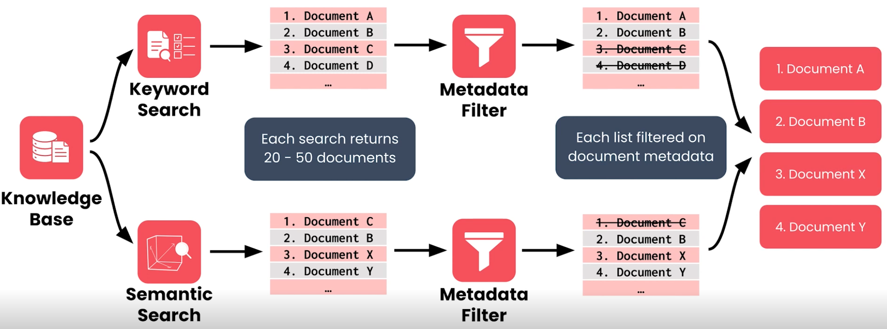

# AI 信息检索和搜索基础

## 检索器架构概述

### 三种不同的检索技术

#### 关键词检索（Keyword Search）

**关键词搜索主要关注用户输入的词语是否出现在文档中。**

例如，用户提问：

> UE5 的 `MotionWarpingComponent` 为什么是 nil？

关键词检索可以优先找到包含以下内容的文档：

- `MotionWarpingComponent`
- `nil`
- `UnLua`
- `GetComponentByClass`

优点： 对类名、函数名、错误码、版本号等精确术语尤其有用。

缺点： 如果文档使用不同的表达方式，即使内容相关，也可能无法被有效检索。

例如，用户搜索“角色移动异常”，而文档标题写的是“CharacterMovementComponent 故障排查”，单纯的关键词匹配可能错过这篇文档。

#### 语义搜索（Semantic Search）

**语义搜索更关注文本的含义，而不是只匹配完全相同的词。**

它通常使用 Embedding 模型把文本转换为向量，再比较查询与文档向量之间的相似程度。

例如：

- 用户查询：为什么角色不能正常移动？
- 文档内容：UE5 中 CharacterMovementComponent 的移动故障排查指南。

两者措辞不同，但表达的主题相近，因此语义搜索可能找到这份文档。

优点： 能发现不同表达方式之间的语义关联。

缺点： 可能漏掉重要的精确术语，也可能找到主题相似但实际上无法解决问题的文档。

#### 元数据过滤（Metadata Filter）

搜索元数据是描述文档属性的信息，而不是文档正文本身。

常见元数据包括：

| 元数据字段      | 示例          | 用途                   |
| --------------- | ------------- | ---------------------- |
| `department`    | `engineering` | 只检索工程部门资料     |
| `document_type` | `tutorial`    | 只检索教程             |
| `version`       | `UE5.6`       | 筛选指定引擎版本的资料 |
| `access_level`  | `internal`    | 根据访问规则筛选资料   |
| `updated_at`    | `2026-10-01`  | 根据更新时间筛选       |

假设知识库中同时包含人力资源文档和工程文档。当工程师查询技术问题时，系统可以根据用户身份和文档属性限制候选范围，避免返回不相关的 HR 资料。

需要注意：元数据过滤本身不负责理解文本语义。它按照明确的条件进行筛选。真正的访问控制还必须由可信的权限校验机制保证，不能只依赖模型自行判断。

### 混合检索（Hybrid Search）

每种搜索方式可能分别返回约 20～50 篇文档。两个结果列表会有重复的文档，但由于检索方式不同，通以文档也可能在排序上有所不同。

此时每份列表会根据元数据进行筛选。例如知识库中的某些文档适用于工程团队成员，其它则更适合人力资源部门的员工，系统会识别用户所属团队，并在此阶段应用元数据筛选以确保只有与该部门相关的文档才能进入下一步。

现在检索器有了两份经过筛选的列表，一份列表来自关键词检索，另一份来自语义检索，这两份列表会合并生成最终的相关性排名，检索器会最从最终列表中返回排名最高的文档，此时检索过程结束。这些文档会被发送用于增强提示词。

以上这种检索方式称为**混合检索**，因为它结合了多种技术来生成最终的文档排名结果。

每种技术都有优势，能提升检索器的整体性能。

* 关键字检索可确保系统对用户在提示中包含的具体词语。

* 语义检索为系统提供了更大的灵活性，可以查找含义与提示相似的文档，即使它们不使用相同的单词。

* 元数据过滤允许系统以其他方法都不允许的方式根据严格的标准排除文档。

设计一个高性能的检索器意味着了解这些技术的相对优势，然后根据项目需求调整它们之间的平衡。

## 元数据过滤

