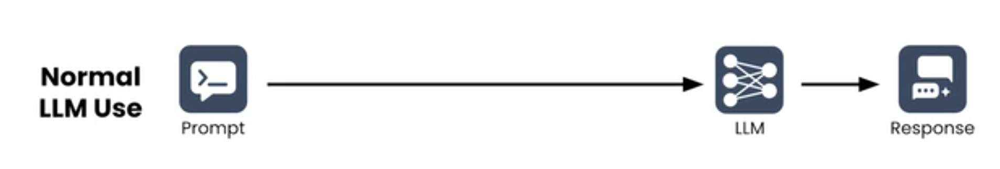
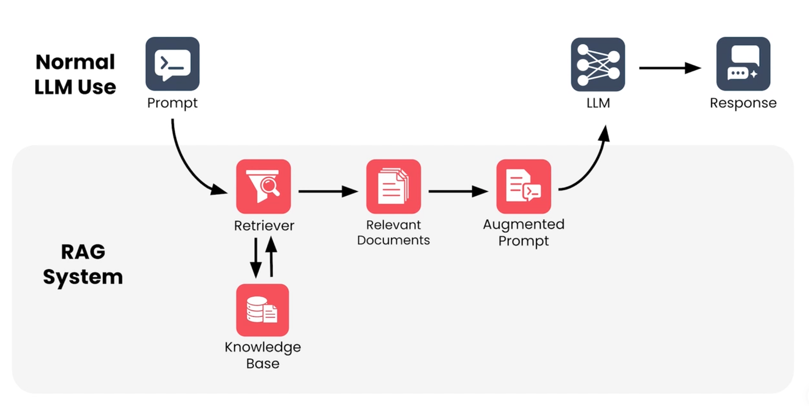

# AI RAG概述

## RAG简介

RAG（Retrieval Augmented Generation，检索增强生成）是目前最常用的 AI 问答方案之一。它的核心思想是：**先从知识库中检索相关内容，把查到的资料拼进提示词,再基于这些内容生成答案**——即"先检索，再生成"。

用个比喻：模型像一个学识渊博但记性有限的顾问。你不让他凭记忆瞎答，而是让他先翻开你指定的那本书，查完再回答。

## RAG的应用

**1. 企业知识库 / 内部问答**

员工问报销规则、请假流程、IT 设备申请、制度文档检索——答案从公司内部手册里查出来，不靠模型瞎编。

**2. 智能客服 / 技术支持**

基于产品手册、FAQ、历史工单回答客户问题；电商、SaaS、运营商场景最常见。

**3. 专业领域问答**

- 法律：合同条款、判例、监管条文检索
- 医疗：临床指南、药品说明、照护规范查询
- 金融：财报、研报、合规政策问答 

**4. 代码库 / 研发助手**

把内部代码、API 文档、编码规范接进去，模型按“你们项目的写法”生成代码，而不是通用写法。

**5. 内容生成与摘要**

基于自有文档做报告摘要、文献综述、周报生成，输出带引用来源。

> RAG 适合的场景 = 数据私有 / 数据会更新 / 答案要能追溯

## RAG的体系结构

通常使用大模型输入提示词给LLM，LLM会处理你的提示词并生成回复。

RAG系统体感上体验差不多，但在RAG系统内部还有很多步骤。当RAG系统收到你的提示词时，它首先会将提示词传递给检索器，检索器可以访问知识库，检索器会向数据库发起查询，返回它认为与提示词最相关的文档，接下来系统会生成一个增强提示词，将相关文档中的信息融入原始提示词，随后增强提示词被发送给LLM由其生成回复。

### RAG的优点

* 注入原本不存在的知识——加入不存在在训练数据的信息
* 减少幻觉——能根据相关内容做出有依据的答复
* 让模型保持实时的更新——通过更新知识库来显示新的信息
* 支持资源引用——生成结果包含引用来源，可追溯核实
* 让模型聚焦于生成文本——检索器负责找事实，大模型负责写回答

## 检索器简介

**Retriever 是 RAG（Retrieval-Augmented Generation，检索增强生成）系统中的核心组件之一。它负责从知识库中找到与用户问题相关的资料，并将这些资料提供给大语言模型（LLM），辅助模型生成回答。**

### 什么是 Retriever？

用图书馆作比喻：假设你想知道“如何在家制作纽约风格披萨”，图书管理员会根据问题，寻找烹饪、意大利料理或纽约披萨相关的书籍，而不是把图书馆里的所有书都搬给你。

RAG 中的 Retriever 就像这位图书管理员。它负责从知识库中找出与问题最相关的文档，再把这些资料交给 LLM 使用。

> **核心区别：LLM 负责根据上下文生成答案，Retriever 负责寻找有用的上下文。**

### Retriever 的工作流程

1. **用户提出问题**：例如“如何制作纽约风格披萨？”
2. **分析查询内容**：理解关键词、主题和语义意图。
3. **搜索知识库索引**：从大量候选文档中查找相关内容。
4. **计算相关性并排序**：评估候选文档与问题的相关程度。
5. **返回选中的文档**：将相关资料交给 RAG 的生成环节。

实际实现方式有很多种。Retriever 可以使用关键词匹配、向量语义搜索，或者把多种检索方式组合起来。

### 知识库与索引

#### 1. 知识库（Knowledge Base）

知识库是 RAG 可以查询的资料集合，例如：

- 产品说明书和技术文档
- 公司内部规章制度
- 项目源代码及开发规范
- 教程、文章和问答记录

这些资料是模型回答问题时可以额外获取的信息来源。

#### 2. 索引（Index）

索引帮助系统更快地找到相关资料，可以将它理解成图书馆的分类系统，或者数据库中用于加速查询的数据结构。

在向量检索中，系统通常会先把文档片段转换成向量，再建立相应的向量索引，以便根据语义相似度查找内容。

**知识库保存可检索的内容，索引帮助系统高效定位内容。**

### 相关性评分（Relevance Score）

Retriever 通常会给候选文档分配相关性分数，并根据分数排序。

以下是一个演示示例，并非真实检索系统的输出：

| 文档   | 内容                       | 示例相关性分数 |
| ------ | -------------------------- | -------------: |
| 文档 A | 纽约风格披萨的面团制作方法 |           0.94 |
| 文档 B | 家用烤箱的披萨烘焙技巧     |           0.87 |
| 文档 C | 意大利甜点的制作方法       |           0.31 |
| 文档 D | 汽车发动机维修手册         |           0.04 |

针对披萨制作问题，文档 A 和 B 显然更值得优先返回。

**注意：相关性分数不一定是概率，也不一定能在不同检索模型之间直接比较。** 它的具体含义取决于使用的检索算法和评分方式。

### Retriever 最难解决的问题：到底返回多少文档？

#### 情况 A：返回太多文档

- 大量无关信息混入 Prompt。
- 消耗更多 Token 和计算资源。
- 可能挤占上下文窗口容量，干扰模型判断。

#### 情况 B：返回太少文档

- 可能遗漏重要信息。
- 排名第二、第三的文档也可能包含关键细节。
- LLM 只能基于不完整的资料作答。

理想的检索器需要同时做到：

1. 尽可能找到真正相关的文档。
2. 尽可能排除无关文档，并控制返回数量。

实际系统很难做到完美排序，所以需要通过测试、监控和参数调整不断优化。

### 常见的检索参数

| 参数                | 作用                           |
| ------------------- | ------------------------------ |
| Top-K               | 返回排名靠前的 K 个结果        |
| 相似度阈值          | 过滤低于指定相关性标准的结果   |
| 检索方式            | 决定使用关键词、向量或混合检索 |
| 重排序（Reranking） | 对初步检索结果进一步评估和排序 |

这些属于常见的工程实践。本节视频主要强调文档排序和返回数量之间的权衡。

### 信息检索与向量数据库

RAG 并不是凭空发明了一种全新的搜索技术。它借鉴了成熟的信息检索（Information Retrieval）领域的许多思想。

#### 常见的检索系统

- **搜索引擎**：根据查询词寻找相关网页，并对结果进行排序。
- **关系型数据库**：根据 SQL 查询条件，筛选符合要求的数据行。
- **向量数据库（Vector Database）**：支持向量的存储和检索，常用于查找语义相近的文档片段。

#### 为什么 RAG 经常使用向量数据库？

向量检索通常需要先通过 Embedding 模型将文本转换成数值向量，再比较查询向量与文档向量之间的相似程度。

例如：

- 用户查询：“怎么修复角色的移动异常？”
- 文档内容：“UE5 CharacterMovementComponent 移动故障排查指南。”

即使两个文本没有使用完全相同的词语，向量检索仍可能识别它们在语义上的关联。

不过，向量数据库并不是 RAG 的强制要求。系统也可以使用传统数据库、全文检索引擎，或者混合方案。实际选择取决于数据结构、检索需求、性能和部署成本。

