# DSH框架

最近DSH插件生态越来越丰富，所以花了一点时间来了解了一下DSH的框架。

## 一句话总结

DSH 基于 Cordis 插件机制，将 Agent 的能力（模型适配、工具注册、日志、agent loop、界面等）全部插件化，支持从配置替换。插件通过共享上下文提供服务、类型化事件和可逆副作用，卸载时自动撤销注册。

不存在需要打补丁的特权内核：扩展 dsh 的方式是把插件挂载到其他插件旁边，而各项注册都是副作用，会在其插件卸载时撤销。

## DSH 与传统扩展式插件系统的区别

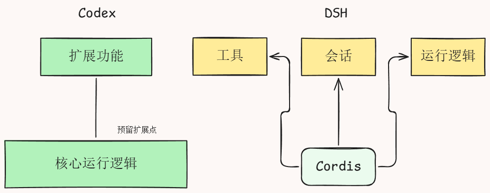

### 传统扩展式插件系统

- 框架预先定义扩展点。
- 插件主要在这些扩展点上增加功能。
- 核心执行流程通常仍由框架控制。

### DSH 的插件化架构

- 工具和辅助能力可以做成插件。
- Agent Loop（驱动任务执行的核心循环）也可以通过插件实现。
- 不同运行模式可以选择不同插件组合。
- 服务实现可以替换，而调用方不必跟着修改，只要接口保持兼容。

**重点：** DSH 的设计更强调整个 Agent 的能力组合方式，而不只是给固定核心添加外围功能。

## 为什么使用 Cordis？

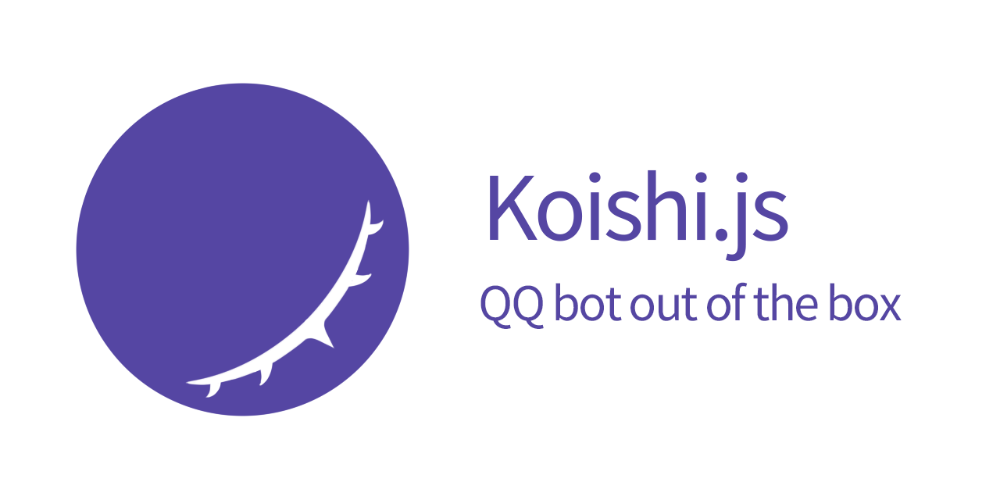

Cordis 为源自聊天机器人项目的插件框架。聊天机器人和 Agent 都需要处理消息、调用外部服务、保存状态、返回结果，因此插件管理机制也有相通之处。

Cordis 帮助解决的问题包括：

- 插件之间如何共享能力。
- 插件如何声明和满足依赖。
- 插件如何在运行时加载、替换或卸载。
- 插件退出时如何清理自己注册的资源。
- 运行环境变化后，相关插件如何调整状态。

## Cordis 的关键机制

###  Context：共享上下文

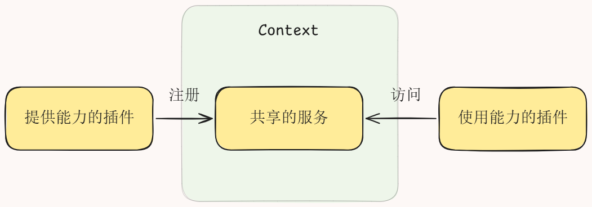

Context 为插件提供共享环境，插件可以通过它注册服务，也可以访问其他插件提供的能力。

可以粗略类比 React Context：共享需要传递的信息或能力，减少逐层传递依赖的需要。但两者的设计和运行机制并不完全相同。

### Service：服务接口与实现分离

Service就是插件提供出来供其它插件调用的一项能力。

Service 将“如何调用一项能力”与“这项能力具体实现”分开。

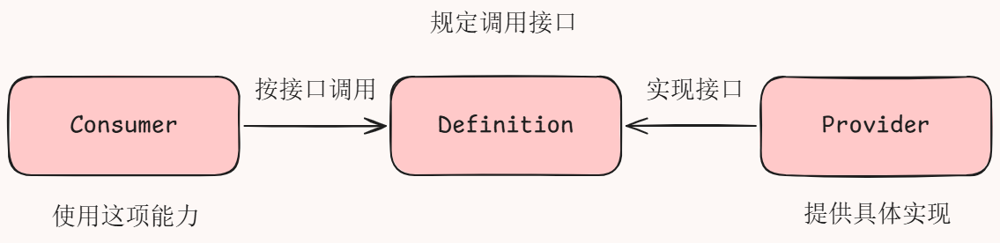

- **Definition**：规定调用接口。
- **Provider**：提供具体实现。
- **Consumer**：使用这项能力。

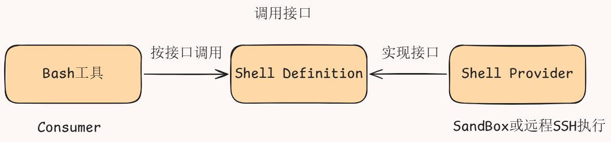

**例子：** Bash 工具需要执行命令，它作为 Consumer 通过约定好的 Shell 接口发起调用。Shell Provider 可以在本机或沙箱执行命令，也可以改成通过 SSH 在远程机器执行。只要接口兼容，Bash 工具就不需要知道底层具体怎么执行。

### Injection：依赖注入与协调

Injection：插件声明自己需要哪些服务，框架根据这些服务是否可用，协调插件的启动与停用。

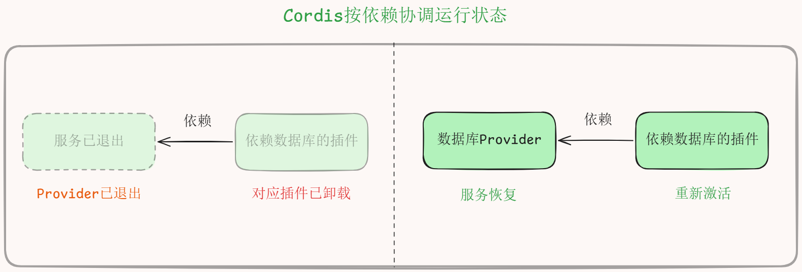

例如：

1. 某插件声明依赖数据库服务。
2. 数据库服务就绪后，插件才具备启动条件。
3. 如果数据库服务被移除，依赖它的插件需要被停用或卸载。
4. 服务恢复后，框架可按依赖规则重新激活相关插件。

这样，插件作者负责声明依赖，框架负责协调依赖变化。

### Event：事件机制与流程介入

Event：插件在约定位置发出事件，其它插件监听并加入处理。

以 **Waterfall** 形式的事件作为例子。可以把它理解为一种允许多个处理者依次介入流程的机制，类似中间件或拦截器。

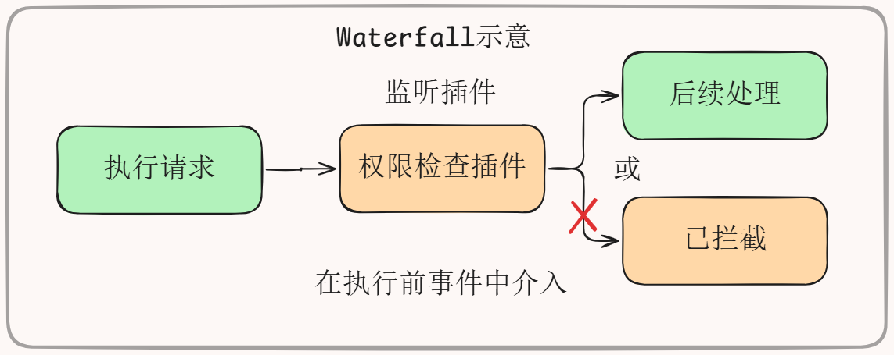

例如，在工具执行前：

1. 执行流程发出事件。
2. 权限插件检查当前操作是否允许。
3. 如果允许，流程继续。
4. 如果不允许，可以拦截；某些设计也可以等待用户确认后再继续。

因此，权限检查和用户审批可以作为独立插件接入，而不必硬编码进每个工具。

### Effect 与 Fiber：副作用和运行实例

- **Effect**：注册一个副作用，并提供相应的清理逻辑。
- **Fiber**：插件加载后创建的运行实例，每个实例有自己的生命周期。

例如，插件启动时注册事件监听器，退出时移除监听器。同一个插件可以创建多个实例；每个实例否哟自己的生命周期。卸载其中一个实例时，应执行对应实例的清理逻辑，而不影响其他实例。

## Agent 如何执行一轮任务？——Agent运行循环

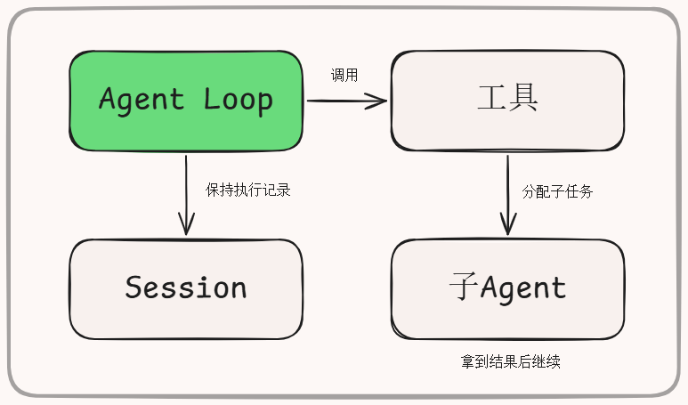

一个agent的任务执行就是大家熟悉的react loop在DSH里，这个过程由agent loop插件来驱动。整个过程中session会保存对话和执行记录。需要分工的时候还可以把一部分任务交给子agent，拿到结果以后再继续在DSH里推动任务的循环。执行工具保存记录以及调用子agent，这些能力都是通过插件组合起来的。

### Turn与Step

* Turn:用户输入后开始的一轮处理。
* Step:准本输入与工具、请求模型，再处理所需工具调用。

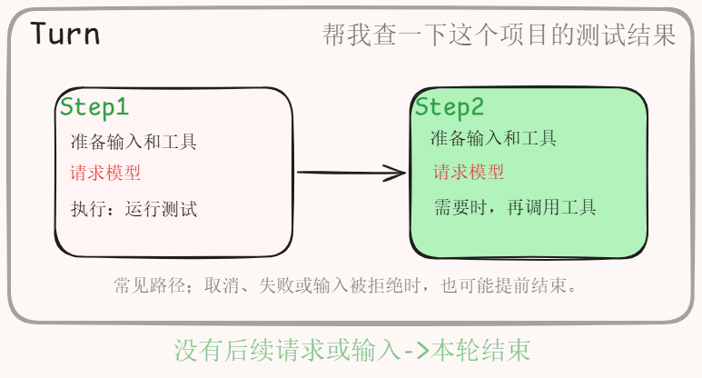

用户输入任务以后，agent开始一轮处理，这一轮叫turn。一轮处理里可能要走好几个step，每个step会准备好当前的输入和工具，向模型发起请求，再处理模型要求的工具调用。比如模型让我们执行了一个工具，拿到结果后通常还得交给模型再看一遍，于是就进入下一个step，继续请求模型需要的话再执行工具，等到没有需要继续处理的请求和输入，这个turn就结束了。当然如果中途取消失败或者输入被拒绝，也可能提前结束。所以你在界面里发出一个任务，背后可能已经请求了好几次模型。而负责推动这一整套过程的agent loop本身也是个插件，这就是开头说的DSH，连agent的运行也放进了插件里。

### 示例：让 DSH 检查 UE5 项目报错

1. 模型分析报错，并要求读取日志。
2. DSH 调用文件读取工具。
3. 工具返回日志内容。
4. 模型再次分析，并要求搜索相关源码。
5. DSH 调用搜索工具。
6. 模型结合结果给出诊断建议。

用户只提交了一次任务，背后却可能发生多次模型请求和工具调用。这些步骤由 Agent Loop 推进，而工具、会话记录和子 Agent 等能力可以由其他插件提供。

## Session 与 Projection：执行记录和视图

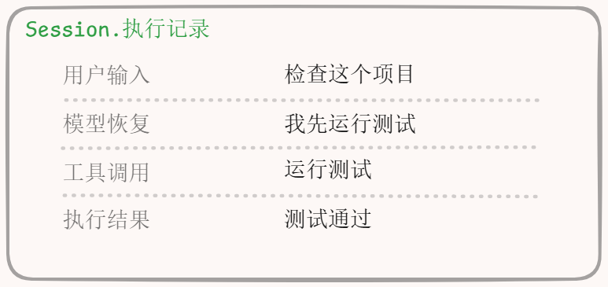

Session 按顺序记录 Agent 执行期间发生的事件，例如用户输入、模型回复、工具调用和工具执行结果。

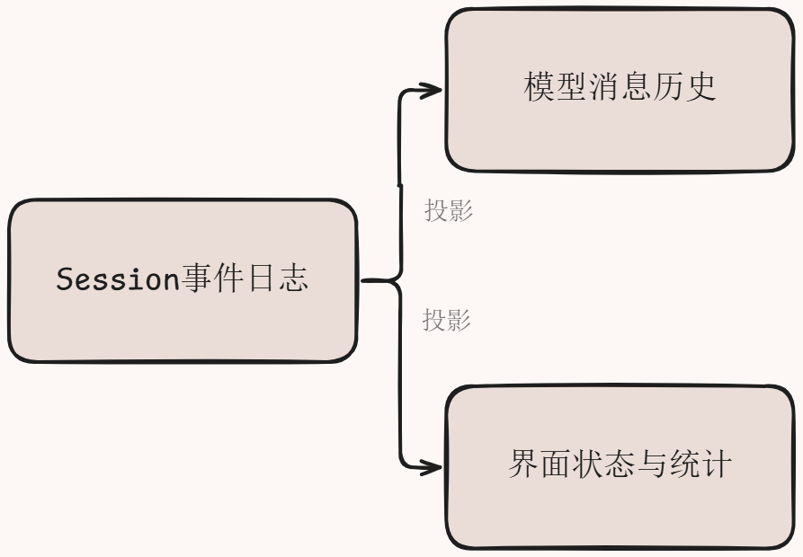

Projection（投影）则根据这些记录，整理出不同用途的视图。

### 银行流水类比

- **Session** 像银行流水，记录每笔交易。
- **Projection** 像余额、账单或统计报表，根据流水生成不同结果。

这种设计让底层执行记录与上层展示方式分离。同一份记录可以用于构建模型消息历史、界面状态和统计信息。

注意：模型实际使用的消息历史通常不是原始事件日志的简单拼接，还可能经过筛选、转换和上下文管理。

## 插件装配与配置

启动DSH的时候，怎么决定把哪些插件放到一起呢？这里就用到bundle profile和patch。

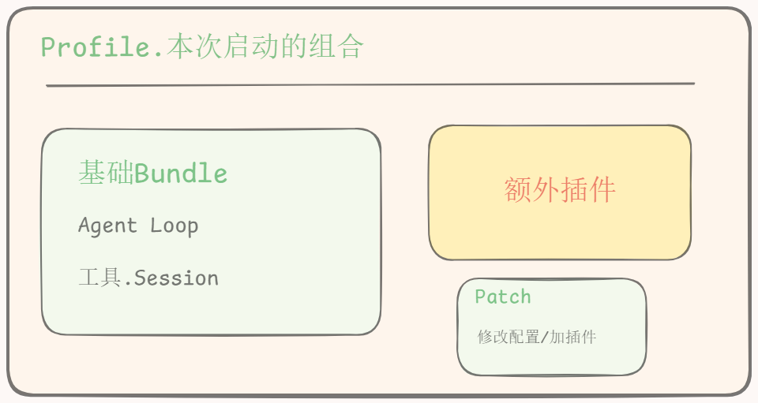

| 概念    | 作用                                 | 类比     |
| ------- | ------------------------------------ | -------- |
| Bundle  | Bundle是打包好的一组插件配置和代码。 | 功能套件 |
| Profile | Profile是启动时使用的一套组合配置。  | 启动方案 |
| Patch   | Patch用来修改配置，或加入新插件。    | 增量变更 |

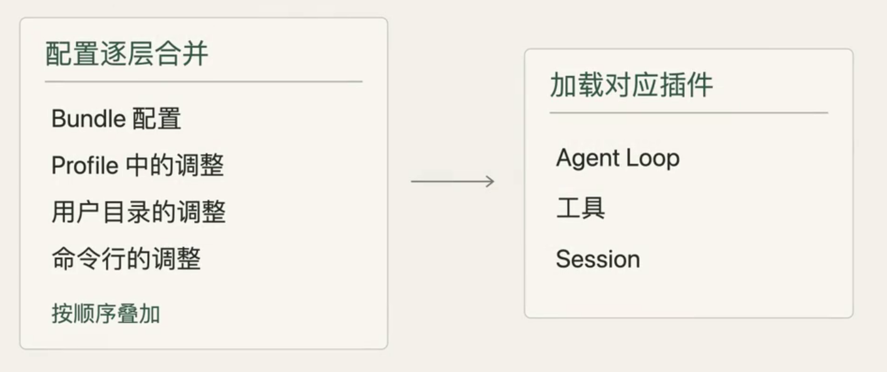

比如修改某个插件的配置或者加入一个新插件。启动时这些配置会按顺序合并，再加载对应的插件

### 组装示意图

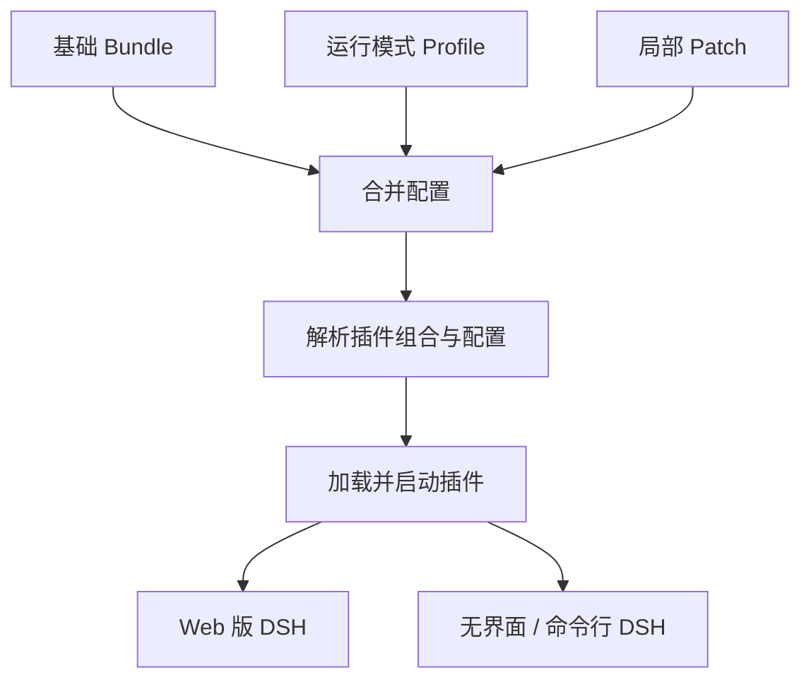

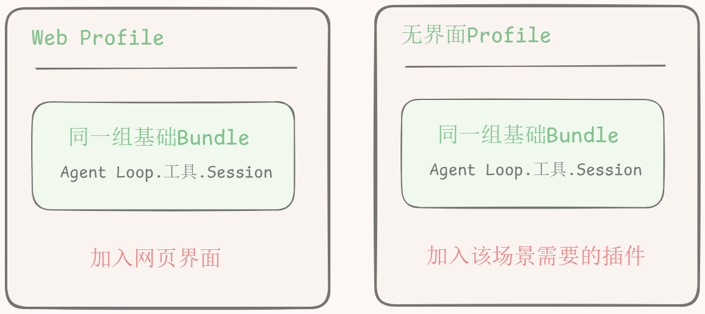

比如带网页界面的DSH和无界面运行的DSH可以共用一组基础插件，再通过各自的profile加上需要的部分。

## 扩展点与插件开发

前面这些概念了解以后，我们就可以看看想给DSH加功能具体应该改哪里。

* Tool:给模型调用的工具。
* Provider:背后能力的具体实现

| 目标                               | 优先考虑的扩展位置                  |
| ---------------------------------- | ----------------------------------- |
| 给模型增加查询资料、搜索文件等工具 | Tool 及其 Provider                  |
| 将 Bash 从本机执行改成远程执行     | Shell 服务的 Provider               |
| 加入权限检查、用户审批或执行拦截   | Event、Waterfall 或执行流程相关插件 |
| 生成执行报告、历史记录或统计数据   | Session、Projection                 |
| 修改交互界面                       | Web Client 及相关前端插件           |

理解这些边界后，添加功能时就不必一开始修改核心逻辑。优先检查已有接口和插件能否复用，再决定是否需要新插件或替换 Provider。

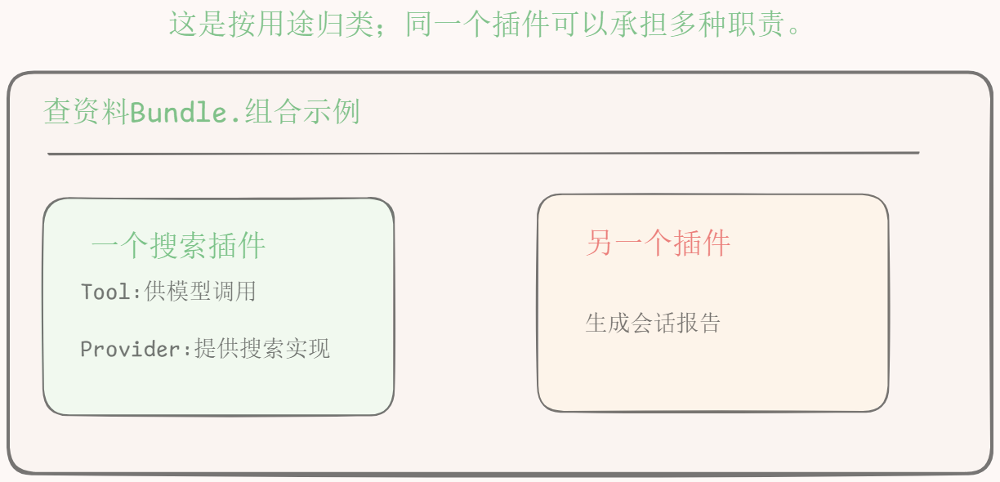

一个插件可以做几件事，几个插件也能一起打包。

### Agen开发插件

可以让Agent来帮我们写插件，这样就可以告诉他开发时该怎么做，需要检查什么。我们先把需求和允许修改的范围告诉Agent，让他看看已有的能力能不能复用，再把需要的功能写成插件，写好以后跑一下测试，再拿实际任务试试。确认结果符合预期，就把插件加进日常使用的profile以后就能直接用上这个功能。

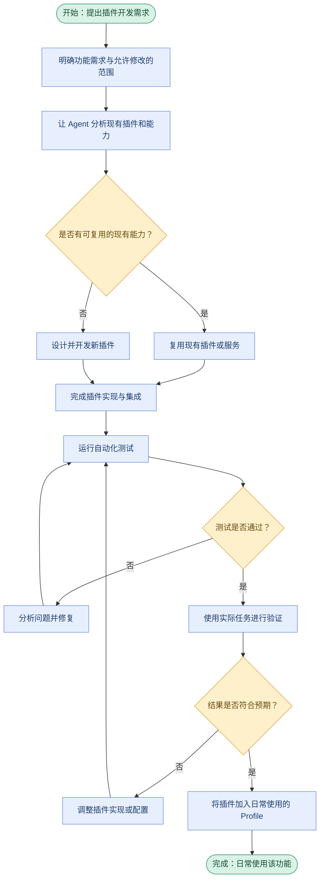

## 总结

回到开头，DSH的一切皆插件就是把Agent loop工具、会话记录这些能力都做成可以组合和替换的插件。

Cordis让插件能找到彼此需要的服务，在依赖变化时调整运行状态，退出时执行对应的清理逻辑。

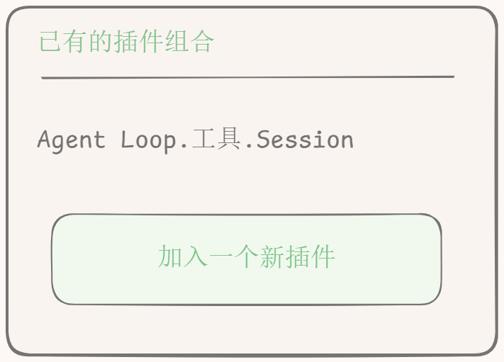

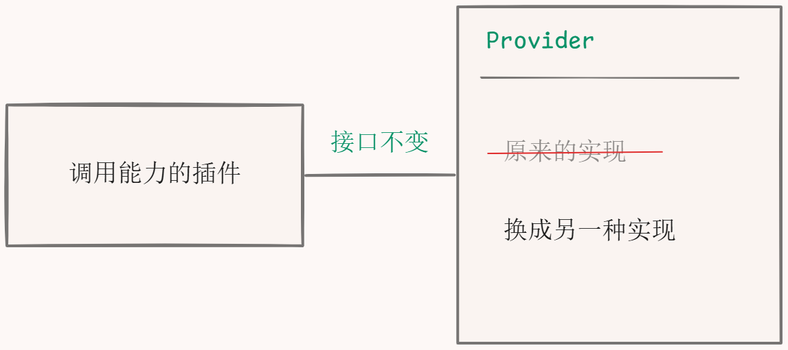

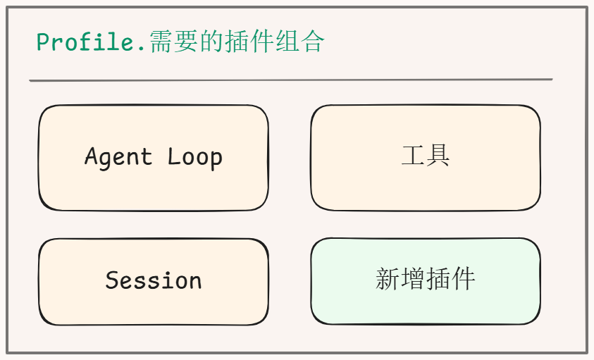

想加功能可以写一个新插件。想换实现可以换provider。最后通过profile把需要的插件组合起来。以后你想改DSH的某个功能就可以先从对应的插件看起。

## 参考

[1](@ref): [DeepSeek DSH 的“一切皆插件”，到底是怎么实现的？]( https://www.bilibili.com/video/BV17Xbp6MEkT/?share_source=copy_web&vd_source=d7e66919757ea91dfd7ac792e3ce6bf1) 

