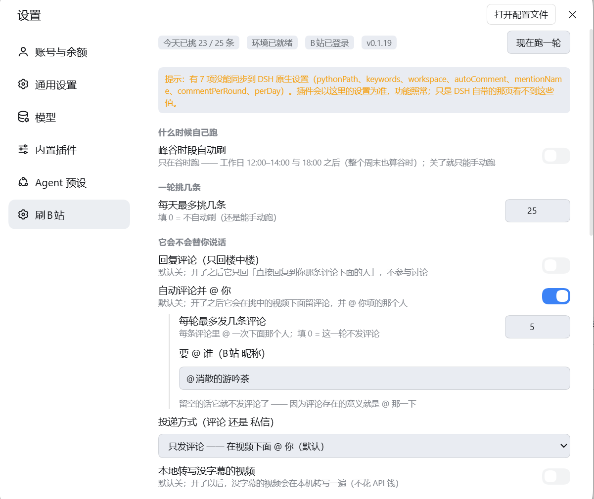

# DSH好用的插件总结


最近发现DSH有趣好用的插件越来越多，就想着单独写一篇用来总结用过的有趣的插件，后续还会更新。。。


## DSH刷b站插件

第一种

* **源码**：[GitHub - c1overzz/dsh-bili-scroll: DSH 插件：每天替你刷一轮 B站，读字幕挑出值得的、写一份日报，值得的 @ 你 · GitHub](https://github.com/c1overzz/dsh-bili-scroll)

- **演示视频**：https://www.bilibili.com/video/BV1d8pU6xEZX/

功能：让deepseek harness可以刷b站的插件，看到有意思的还会分享给你。

可以通过设置来让DSH刷B站。

第二种

* **源码**：https://github.com/Alterssss/dsh-bili-whale
* **演示视频**【大肥鱼成精了：它按自己的作息刷B站，不理它还会闹脾气】 https://www.bilibili.com/video/BV1EPnG6DEJC/?p=2&share_source=copy_web&vd_source=d7e66919757ea91dfd7ac792e3ce6bf1

功能：给 DSH 装一条有日子的鱼：自己按作息刷 B 站、真看懂视频、写两本日记，把值得的 @ 你。

## DSH插件市场

* **源码**：[dsh-market/dsh-market: The plugin market inside DeepSeek Harness — browse, search, one-click install · DSH 可视化插件市场](https://github.com/dsh-market/dsh-market)
* 官网:[DeepSeek Harness 插件市场 — 6378 个 dsh 插件 · dsh-market](https://dshmarket.com/zh/)

功能:dsh-market 就是装在 DeepSeek Harness（简称 dsh）里的插件市场：**6565 个社区插件**，逛一逛，点一下，装好——多数插件连重启都不用。更新、卸载、实时安装进度，零遥测。

